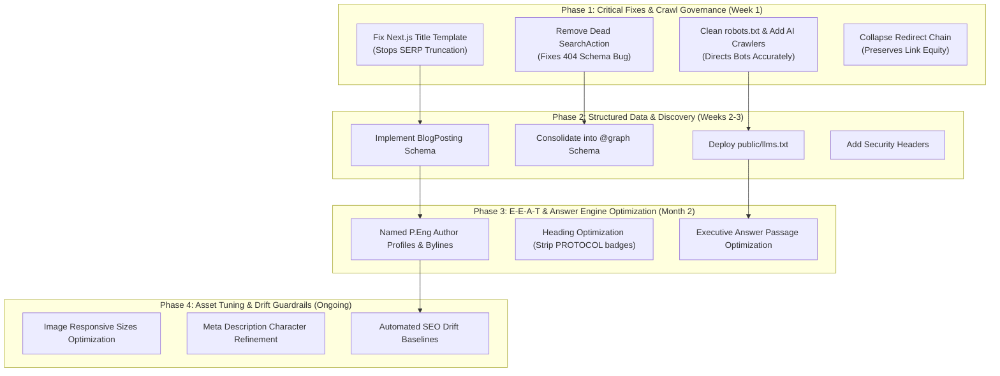

# Prioritized SEO Action Plan — AEGI.ca

This document outlines the sequenced, falsifiable action roadmap for **Advanced Engineering Group Inc. (AEGI)**. Tasks are ordered strictly by business impact and dependency sequencing.

---

## Dependency & Implementation Sequencing



---

## Phase 1: Critical Fixes & Crawl Governance (Immediate / Week 1)

### ACTION-01: Remove Dead Sitelinks Searchbox (`SearchAction`) in `WebSite` Schema
* **Priority**: Critical (Schema / Penalty Risk)
* **Specific Observation (Evidence)**:
  `WebSite` schema on homepage targets `https://www.aegi.ca/search?q={search_term_string}` which returns **HTTP 404 Not Found**.
* **Concrete Action Step**:
  In `components/Schema.tsx` or `app/layout.tsx`, remove the `potentialAction: SearchAction` property completely until an actual search page `/search` exists.
* **Dependencies**: None. Can be deployed immediately.
* **Leading Indicator**: Google Rich Results Test passes with 0 action errors.
* **Falsifiability Test**: If `curl -I https://www.aegi.ca/search?q=test` returns 404 while `potentialAction` remains in page source, this fix failed.

---

### ACTION-02: Fix Next.js Title Template Double-Branding
* **Priority**: High (SERP Visibility & CTR)
* **Specific Observation (Evidence)**:
  All 13 blog articles reach 90–110 characters (e.g. `Haul Road Design: 7 Key Engineering Considerations | AEGI Alberta | AEGI - Advanced Engineering Group Inc.`), exceeding Google's 60-character / 580px truncation limit.
* **Concrete Action Step**:
  In `app/layout.tsx`, update `metadata.title`:
  ```typescript
  title: {
    template: '%s | AEGI Engineering',
    default: 'AEGI Engineering | Professional Engineering in Alberta',
  }
  ```
  Ensure individual page titles are drafted between 40–55 characters before template appending.
* **Dependencies**: Unblocks BlogPosting schema generation in Phase 2.
* **Leading Indicator**: Search engine preview tools show zero title truncation ellipsis (`...`).
* **Falsifiability Test**: If Google Search Console shows title lengths > 65 characters in SERP impressions, template bloat persists.

---

### ACTION-03: Modernize `robots.txt` & Allow AI Search Crawlers
* **Priority**: High (Crawl Budget & GEO)
* **Specific Observation (Evidence)**:
  Site contains legacy WordPress disallows (`/wp-content/`, `/wp-admin/`, `/wp-includes/`) on a Next.js platform and provides zero guidance for AI search engines.
* **Concrete Action Step**:
  Update `public/robots.txt`:
  ```text
  User-Agent: *
  Allow: /
  Disallow: /api/
  Disallow: /admin/

  # AI Search & Retrieval (Allow)
  User-agent: OAI-SearchBot
  Allow: /

  User-agent: Claude-SearchBot
  Allow: /

  User-agent: PerplexityBot
  Allow: /

  Sitemap: https://www.aegi.ca/sitemap.xml
  ```
* **Dependencies**: Unblocks `llms.txt` discovery in Phase 2.
* **Leading Indicator**: GSC robots.txt testing tool reports 0 warnings and valid sitemap linkage.
* **Falsifiability Test**: If crawler logs show bot rejections or 404 queries for WordPress paths, the old robots.txt remains cached or active.

---

### ACTION-04: Consolidate Non-Secure / Non-WWW Redirect Chain
* **Priority**: Medium (Technical Infrastructure)
* **Specific Observation (Evidence)**:
  `http://aegi.ca` redirects through two hops (`http://aegi.ca` $\rightarrow$ 308 $\rightarrow$ `https://aegi.ca/` $\rightarrow$ 301 $\rightarrow$ `https://www.aegi.ca/`).
* **Concrete Action Step**:
  Update edge redirect rules in `vercel.json` or DNS settings so `http://aegi.ca` and `https://aegi.ca` both redirect directly to `https://www.aegi.ca/` with a single 301 Permanent Redirect.
* **Dependencies**: None.
* **Leading Indicator**: `curl -ILs http://aegi.ca` executes exactly one redirect hop.
* **Falsifiability Test**: If response history contains $>1$ status code before 200, edge configuration failed.

---

## Phase 2: Structured Data & Discovery (Weeks 2–3)

### ACTION-05: Implement Dynamic `BlogPosting` Schema
* **Priority**: High (Structured Data)
* **Specific Observation (Evidence)**:
  All 13 blog posts completely lack `Article` or `BlogPosting` schema, preventing Google and AI engines from recognizing author, publication date, or headline entity data.
* **Concrete Action Step**:
  In `app/blog/[slug]/page.tsx`, inject dynamic `BlogPosting` JSON-LD with: `headline`, `image`, `datePublished`, `dateModified`, `author`, `publisher`, and `description`.
* **Dependencies**: Requires named author entities (Phase 3).
* **Leading Indicator**: Google Search Console URL Inspection confirms "Article" rich snippet eligibility.
* **Falsifiability Test**: If Rich Results Test reports "No Article structured data found" on any blog URL, component injection failed.

---

### ACTION-06: Deploy `public/llms.txt` for AI Search Ingestion
* **Priority**: High (GEO / AI Overviews)
* **Specific Observation (Evidence)**:
  `https://www.aegi.ca/llms.txt` returns 404. LLMs lack an authoritative summary of AEGI's engineering services and licensing jurisdictions.
* **Concrete Action Step**:
  Create and deploy `public/llms.txt` outlining AEGI's engineering capabilities, APEGA permit status, regional offices (Edmonton/Calgary), and links to primary service pages.
* **Dependencies**: Requires modernized `robots.txt` from Phase 1.
* **Leading Indicator**: `scripts/agentic_check.py` returns green (HTTP 200) for `llms.txt`.
* **Falsifiability Test**: If requesting `/llms.txt` yields a 404 status code, deployment to Vercel was missed.

---

### ACTION-07: Implement Standard Security Headers in Next.js
* **Priority**: Medium (Technical & Security)
* **Specific Observation (Evidence)**:
  HTTP response headers lack `X-Frame-Options`, `X-Content-Type-Options: nosniff`, and `Referrer-Policy`.
* **Concrete Action Step**:
  Add `headers()` configuration in `next.config.js` to enforce `X-Frame-Options: DENY`, `X-Content-Type-Options: nosniff`, and `Referrer-Policy: strict-origin-when-cross-origin`.
* **Dependencies**: None.
* **Leading Indicator**: Securityheaders.com rating improves from D/F to A/A+.
* **Falsifiability Test**: If browser DevTools Network tab shows missing `X-Content-Type-Options`, next.config.js headers failed to compile.

---

## Phase 3: E-E-A-T & Authority Signals (Month 2)

### ACTION-08: Introduce Named P.Eng Author Profiles & Bylines
* **Priority**: High (E-E-A-T & Quality Signals)
* **Specific Observation (Evidence)**:
  Technical analyses of high-stakes civil and structural topics are published under generic company branding with zero individual author accountability.
* **Concrete Action Step**:
  1. Add author cards with engineer name, P.Eng designation, and APEGA license number.
  2. Create bio routes (`/about/team/[slug]`) linked to verified LinkedIn and engineering association profiles.
  3. Map author URLs into `BlogPosting.author.url`.
* **Dependencies**: Depends on dynamic `BlogPosting` schema from Phase 2.
* **Leading Indicator**: Increased branded organic search queries for lead engineers and higher rankings for competitive commercial queries.
* **Falsifiability Test**: If articles display generic bylines without individual accreditation after 60 days, E-E-A-T implementation failed.

---

### ACTION-09: Restructure Heading Hierarchy on Technical Guides
* **Priority**: Medium (On-Page SEO)
* **Specific Observation (Evidence)**:
  Blog titles contain internal numbering badges in `<h1>` tags (e.g. `PROTOCOL #008StormwaterManagementDesign...`), diluting keyword weight.
* **Concrete Action Step**:
  Move protocol identifiers into independent `<span class="badge">` elements above the `<h1>`. Ensure `<h1>` begins directly with the target keyword phrase.
* **Dependencies**: None.
* **Leading Indicator**: DOM heading outlines cleanly reflect primary target keywords in SEO crawlers.
* **Falsifiability Test**: If rendered `<h1>` innerText still contains "PROTOCOL #", component refactoring failed.

---

### ACTION-09: Optimize Passage Structure for Google AI Overviews & Perplexity
* **Priority**: High (GEO)
* **Specific Observation (Evidence)**:
  Articles lack concise 40–60 word definitive definition boxes answering high-value informational questions.
* **Concrete Action Step**:
  Add a dedicated "Key Takeaways" or "P.Eng Definition" callout at the beginning of each technical post answering core questions directly.
* **Dependencies**: Unblocked by Action 09.
* **Leading Indicator**: Site content begins appearing as a cited reference in Perplexity and Google AI Overviews.
* **Falsifiability Test**: If zero AI Overview citations occur after 90 days, passage answers are insufficiently concise or lack entity prominence.

---

## Phase 4: Asset Optimization & Drift Baselines (Ongoing)

### ACTION-10: Optimize Next.js Image Responsive `sizes` Attributes
* **Priority**: Medium (Performance / CWV)
* **Specific Observation (Evidence)**:
  Branding logo requests unconstrained 3840px image assets (`w=3840`) across mobile viewports.
* **Concrete Action Step**:
  Add `sizes="(max-width: 768px) 160px, 220px"` to `<Image>` components in navbar and hero templates.
* **Dependencies**: None.
* **Leading Indicator**: Mobile network waterfall shows image requests capped at $\le 384\text{px}$.
* **Falsifiability Test**: If network logs show `w=3840` requests from mobile user-agents, the `sizes` attribute is ineffective.

---

### ACTION-11: Establish Automated SEO Drift Monitoring
* **Priority**: Low (Long-Term Stability)
* **Specific Observation (Evidence)**:
  Next.js template modifications frequently cause accidental regressions in meta titles and structured data.
* **Concrete Action Step**:
  Capture an initial drift baseline using `python scripts/drift_baseline.py https://www.aegi.ca/` and integrate `drift_compare.py` into production CI/CD deployment checks.
* **Dependencies**: Best run after Phase 1 and Phase 2 fixes are live.
* **Leading Indicator**: CI/CD alerts trigger automatically upon unauthorized title or schema regressions.
* **Falsifiability Test**: If metadata changes deploy to production without generating a drift delta alert, monitoring hooks failed.

---

━━━━━━━━━━━━━━━━━━━━━━━━━━━━━━━━━━━━━━━━━━━━━━━━━━━━━━━━━━
Audit Prepared & Verified by: Syed Mesum Ali Shah
Full-Stack Engineer & Technical SEO Specialist
🌐 Portfolio: https://www.mesumali.xyz
💼 LinkedIn: https://www.linkedin.com/in/mesumali-dev
━━━━━━━━━━━━━━━━━━━━━━━━━━━━━━━━━━━━━━━━━━━━━━━━━━━━━━━━━━
