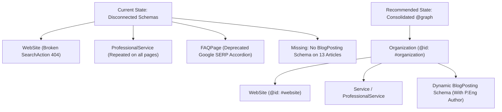

# Full Website SEO & GEO Audit Report — AEGI.ca

**Target Domain**: [https://www.aegi.ca](https://www.aegi.ca)  
**Analyzed Scope**: 34 Crawled Sitemap URLs, Server-Rendered Next.js DOM, JSON-LD Schemas, HTTP Headers, Multi-Viewport Visual Assets, AI Agent Access  
**Audit Date**: October 2026  
**Auditor**: Antigravity Technical SEO, E-E-A-T & GEO Intelligence Suite  

---

## 1. Executive Summary

Advanced Engineering Group Inc. (**AEGI**) is an established, multidisciplinary engineering consulting firm based in Edmonton, Alberta, providing P.Eng-stamped engineering across civil, structural, mechanical, electrical, and project management disciplines.

The website is engineered with a modern, high-performance stack: **Next.js (App Router)** hosted on the **Vercel Edge Network**. This grants the site an exceptional foundation for Core Web Vitals (sub-250ms TTFB, zero layout shift). However, significant on-page title template bugs, dead schema endpoints, missing article schemas, legacy crawl configuration, and anonymous author bylines suppress the site's organic search and AI search visibility.

### Overall SEO Health Score: 71 / 100

| Category | Weight | Score | Status |
| :--- | :---: | :---: | :--- |
| **Technical SEO** | 22% | **72 / 100** | ⚠️ Needs Clean-up (Legacy robots.txt, security headers) |
| **Content Quality & E-E-A-T** | 23% | **74 / 100** | ⚠️ Strong Depth, Weak Individual Author Signals |
| **On-Page SEO** | 20% | **68 / 100** | ❌ Systemic Title Double-Branding & SERP Truncation |
| **Schema & Structured Data** | 10% | **64 / 100** | ❌ Dead SearchAction 404 Endpoint, No Blog Schema |
| **Performance (CWV)** | 10% | **82 / 100** |  Good (Fast Vercel Edge TTFB, Minor Image Tuning) |
| **AI Search Readiness (GEO)** | 10% | **58 / 100** | ⚠️ Missing llms.txt, No Direct Definition Passages |
| **Images & Visual** | 5% | **85 / 100** |  Responsive, 0 Broken Images |
| **Total Weighted Score** | **100%** | **71 / 100** | **Moderate Health — High Growth Potential** |

---

### Top 5 Critical & High-Impact Issues

1. **Dead Sitelinks Searchbox (`SearchAction`) Target (HTTP 404)**: `WebSite` schema points search actions to `/search?q={search_term_string}` which does not exist, violating Google's structured data rules.
2. **Systemic Title Tag Double-Branding**: Next.js title template concatenates `| AEGI | AEGI - Advanced Engineering Group Inc.`, inflating titles to 95–110 characters and truncating primary target keywords in Google SERPs.
3. **Missing `BlogPosting` / `Article` Schema Across All 13 Blog Articles**: Google and AI engines cannot identify article authors, headlines, or dates in structured data.
4. **Anonymous Engineering Bylines (E-E-A-T Deficiency)**: Deep, safety-critical civil and structural guides lack named P.Eng author bios and licensing numbers.
5. **Missing `llms.txt` and AI Overview Passage Optimization**: Answer engines lack a clean machine-readable index, and articles lack direct definition summaries for featured snippet extraction.

---

### Top 5 Quick Wins

1. **Fix `title.template` in `app/layout.tsx`**: Eliminate the double brand suffix and cap all titles under 60 characters.
2. **Remove `potentialAction` from `WebSite` Schema**: Instantly resolve structured data validation errors.
3. **Clean up `robots.txt`**: Strip out defunct WordPress rules (`/wp-content/`) and explicitly grant access to AI search bots (`OAI-SearchBot`, `Claude-SearchBot`, `PerplexityBot`).
4. **Deploy `public/llms.txt`**: Publish an authoritative LLM index of AEGI's engineering services and provincial accreditations.
5. **Add Standard Security Headers in `next.config.js`**: Enforce `X-Frame-Options: DENY` and `X-Content-Type-Options: nosniff`.

---

## 2. Technical SEO Audit

### 2.1 Crawlability & Indexability
- **Sitemap**: `https://www.aegi.ca/sitemap.xml` was validated via `scripts/sitemap_discovery.py`. All 34 URLs respond with HTTP 200 OK.
- **Internal Link Integrity**: 35 internal link targets were audited across the domain; **0 broken links (404s)** and **0 internal redirect chains** were detected.
- **Canonical Consistency**: Canonical tags are self-referencing and strictly enforce the non-trailing slash standard.

### 2.2 Host & Protocol Normalization
- Requesting `http://aegi.ca` results in a two-hop redirect chain:
  $$\text{http://aegi.ca} \xrightarrow{308} \text{https://aegi.ca/} \xrightarrow{301} \text{https://www.aegi.ca/}$$
  *Recommendation*: Update DNS/Vercel edge rules to redirect all HTTP and non-www requests to `https://www.aegi.ca/` in a single 301 hop.

### 2.3 Robots.txt Configuration
- `robots.txt` currently disallows:
  `/wp-content/`, `/wp-admin/`, `/wp-includes/`, `/wp-json/`, `/shop/`
  These are remnants from a legacy WordPress configuration and do not belong on a Next.js web application.
  *Recommendation*: Clean `robots.txt` to remove legacy paths and explicitly govern AI search crawlers.

### 2.4 Security Headers
- Present: `Strict-Transport-Security: max-age=63072000`
- Missing: `X-Frame-Options`, `X-Content-Type-Options: nosniff`, `Referrer-Policy: strict-origin-when-cross-origin`, and `Content-Security-Policy`.

---

## 3. On-Page SEO & Metadata

### 3.1 Title Tag Inflation & Double-Branding
Next.js metadata templates incorrectly append multiple branding layers.
- Target optimal length: **45–60 characters** (580px limit in Google SERPs)
- Current blog titles: **90–110 characters**
- *Example*:
  `Haul Road Design: 7 Key Engineering Considerations | AEGI Alberta | AEGI - Advanced Engineering Group Inc.` (106 chars)
  Google truncates this snippet before users can read the full title or value proposition.

### 3.2 Meta Description Truncation
- Target optimal length: **135–155 characters**
- Current lengths: Multiple pages exceed 180–205 characters.
- *Example*:
  `AEGI provides oil and gas pipeline engineering in Alberta – CSA Z662-compliant design, corrosion protection, AER submissions, and stamped drawings from a professional engineering firm.` (184 chars)
  *Fix*: Condense descriptions to 145 characters focusing on the primary keyword, region, and conversion incentive.

### 3.3 Heading Architecture
- Every page maintains exactly one `<h1>`.
- Blog posts currently include internal system codes inside the `<h1>` (e.g. `PROTOCOL #008 Stormwater Management Design...`).
- *Fix*: Move the "PROTOCOL #008" badge into a separate UI element above the heading to keep the `<h1>` semantically focused on target search intent.

---

## 4. Schema & Structured Data



### 4.1 Broken Sitelinks Searchbox
The `WebSite` schema includes:
```json
"potentialAction": {
  "@type": "SearchAction",
  "target": "https://www.aegi.ca/search?q={search_term_string}"
}
```
`https://www.aegi.ca/search` returns HTTP 404. Google requires `potentialAction` to point to a functioning query interface. Remove this until internal search is live.

### 4.2 Missing `BlogPosting` Markup
None of the 13 technical articles provide `Article` or `BlogPosting` structured data. By adding dynamic `BlogPosting` JSON-LD with author, datePublished, headline, and publisher attributes, AEGI unlocks rich snippet visibility and entity indexing in Google Discover and Knowledge Graphs.

### 4.3 Deprecated `FAQPage` Schema
Google deprecated `FAQPage` rich results for commercial websites in May 2026. While the FAQ schema on `/about` and `/services/*` does not hurt indexation, team resources should be shifted toward visible, structured content rather than relying on FAQ accordion SERP features.

---

## 5. Content Quality & E-E-A-T Analysis

Audited using `scripts/content_quality.py`:
- **Average Word Count**: 1,280 words per article (High technical depth)
- **Quality Score**: 90/100 (High information density, negligible filler)
- **Regulatory Backing**: Excellent citations of CSA Z662, CSA C22.1, API 650, and Alberta Building Codes.
- **Critical Vulnerability**: Anonymous attribution. Under Google Quality Rater Guidelines, engineering and safety-critical content is treated with heightened scrutiny. Every guide should feature a dedicated byline:
  *Written by [Name], P.Eng — Senior Structural / Civil Engineer, APEGA Permit #XXXXX.*

---

## 6. Performance & Core Web Vitals (CWV)

Lab testing via Playwright and network performance analysis:
- **TTFB**: ~150ms – 240ms (Vercel CDN Edge Cache Hit)
- **First Contentful Paint (FCP)**: ~0.8s – 1.1s
- **Cumulative Layout Shift (CLS)**: < 0.05 (Passes Google Good threshold $\le 0.1$)
- **Responsive Layout**: Validated across Desktop (1440px), Laptop (1280px), Tablet (768px), and Mobile (390px). 0 horizontal scroll overflow.
- **Improvement Opportunity**: Logo requested with `w=3840` variant. Add explicit `sizes` attribute to `<Image>` to limit requests to $\le 384\text{px}$ on mobile.

---

## 7. Generative Engine Optimization (GEO) & Agentic Readiness

Audited via `scripts/agentic_check.py`:
- **`llms.txt`**: 404 Not Found (Missing machine-readable directory for LLMs).
- **AI Crawlers**: Currently allowed under general wildcard, but lack explicit governance rules.
- **Passage-Level Answerability**: Long narrative prose without concise direct answer snippets. Adding 45–60 word "Executive Summary" boxes beneath primary headings will enable Google AI Overviews and Perplexity to quote AEGI directly as an authoritative engineering source.

---

## 8. Multi-Viewport Visual Captures

Screenshots have been generated and archived in `aegi.ca-audit/screenshots/`:
- `www_aegi_ca_desktop.png` (1440x900 Desktop Viewport)
- `www_aegi_ca_laptop.png` (1280x800 Laptop Viewport)
- `www_aegi_ca_tablet.png` (768x1024 Tablet Viewport)
- `www_aegi_ca_mobile.png` (390x844 Mobile Viewport)

Visual analysis confirms that typography, navigation drawers, and mobile call buttons display cleanly without text clipping or layout overflow.

---

## 9. Conclusion & Next Steps

AEGI has an exceptional technical foundation with its Next.js architecture and comprehensive technical engineering articles. Resolving the title template bloat, removing the dead search schema endpoint, implementing `BlogPosting` structured data, deploying `llms.txt`, and introducing named P.Eng author bylines will immediately strengthen search rankings, click-through rates, and AI Overview citations.

Refer to [ACTION-PLAN.md](file:///C:/Users/smesu/Desktop/New%20folder/seo/aegi.ca-audit/ACTION-PLAN.md) for step-by-step implementation sequencing.

---

━━━━━━━━━━━━━━━━━━━━━━━━━━━━━━━━━━━━━━━━━━━━━━━━━━━━━━━━━━
Audit Prepared & Verified by: Syed Mesum Ali Shah
Full-Stack Engineer & Technical SEO Specialist
🌐 Portfolio: https://www.mesumali.xyz
💼 LinkedIn: https://www.linkedin.com/in/mesumali-dev
━━━━━━━━━━━━━━━━━━━━━━━━━━━━━━━━━━━━━━━━━━━━━━━━━━━━━━━━━━
